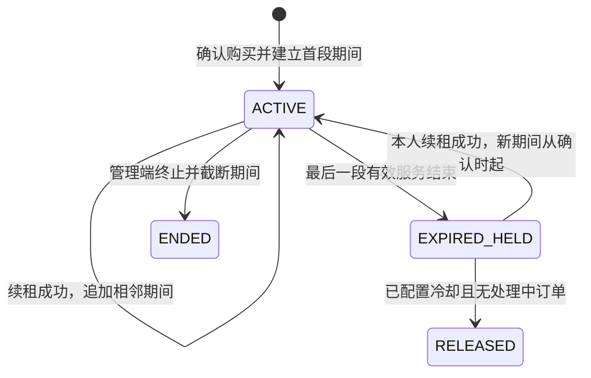

# S4 · ONCE 功能迁入共用核心设计

> 2026-11-06 起按 [v4.2 总执行文档](../handoff/lp-once-v41-master-plan.md) 重排。下文是旧 S4 设计与过程，不是当前整包实施授权。保留未冲突的自营租约/收信/钱包语义；跨站合并、固定账户 B、跨类型统一互斥及代理站内销售路径撤回。代理登录以可信 subject 和自有连接为范围，可查看本连接验证码，不以伪造客户订单/使用权实现。PC 买号、上游续期和划拨只在 PC 完成；当前仍只用 Mock。结果写回总文档第 10.3 节，写库另需授权。

状态：设计已获用户批准，S4 代码实现进行中；迁移、数据导入和业务演示尚未执行或验收。

依据：[执行方案 S4](../handoff/lp-once-unification-plan.md#s4--迁入-once-功能先出设计说明批准后再写代码)、[数据库方案第 0 节](../handoff/unified-core-database-proposal.md#0-批准结论与删减优先于下文)、[S3 实施与验收](s3-points-wallet.md#9-实施验收与本轮证据)。冲突时沿用用户最新决定和数据库方案第 0 节。

## 0. 本设计的批准范围

### 2026-11-06 R3接收修订

下述规则用于当前实现，覆盖本节历史范围及旧S4中相冲突的接口假设：

| 领域 | 当前接收规则 |
| --- | --- |
| 部署与账号 | 相同核心代码分别运行LP/ONCE的API和worker，分别连接本站库；Cookie、Origin、密码重置与PC应用独立，不合并用户/资金 |
| 自营资源 | 由服务端配置选择已授权运营自营连接，不写死账户B或UUID；只从已同步、来源未缺失且有限资源期限覆盖的现货提供服务 |
| 租赁履约 | 本站租约和续租授予本地服务期间，不模拟PC买号/上游续期；持续保留稳定租约、多段期间、空窗、EXPIRED_HELD、幂等与冻结语义 |
| 消息与发送 | 用户GET只读本地；worker拉取入站及处理持久发送任务；未知结果不盲目重发，迟到短信按真实历史期间归属；SSE使用本站会话 |
| 代理权限 | PinClode可信subject映射本站代理，按自有连接看码/配置能力和套餐，不创建客户订单/期间，不操作自营钱包；旧分销写入停用 |
| 财务 | 复用本站S3钱包，保留部分/全额消费退积分和历史退款；Mock支付观察与对账由worker推进，不伪造现金退款成功 |
| 导入 | legacy ONCE只进入独立ONCE目标库；保留原始provider、账户、ID、金额和期间；历史来源账户为不可运营引用，不合并LP同邮箱账户 |
| 页面 | R4已在本轮范围，接通两个前端及各站后台，保留各自视觉；旧S4“不改ONCE前端”的限制不再适用于当前R4 |
| 数据库 | 新037–041承接，旧033–036保留原件；不修改既有迁移，尚未执行迁移/导入/写库演示 |

原S4接口路径可继续使用`/api/once`。具体签名以已集成共享契约、控制器与总文档实际记录为准，不为保留旧响应形状隐瞒不支持的能力。后续历史正文保留当时批准和实施过程。

### 历史批准范围

S4 实现共用 NestJS 核心中的 ONCE 号码目录、租赁/续租、使用期间、收发短信、聊天、Mock 充值、消费退积分、历史退款单和管理接口。自营账号与积分钱包共用；号码资源只使用账户 B：`pingcode-mock / mock-once / once`，内部账户 UUID 为 `00000000-0000-4000-8000-000000000032`。资源门店仍从 `upstream_accounts.storefront_id` 推出，号码不新增门店字段。

保留 `number_allocations`、代理持有/授权链和币种结算；不复制 legacy 的 `pingcode.client`、`payment.gateway`、Prisma 访问层或另一套钱包。C 端继续使用核心 `orders`，增加产品类型。只接 Mock，不连接真实 PC、支付、SIP 或邮箱服务，不引入依赖、新哈希算法或请求哈希。

本设计沿用 S3 已批准的“近期不做现金退款、不建积分批次/分摊”。因此：

- 原消费退积分继续实现，支持部分/全额和幂等。
- 原 `RefundOrder` 的现金退款历史迁入只读 `refund_orders`，不是删除或忽略这些订单。
- 充值退现金、现金退款审批/执行/查单、未入账实收退回和“仅扣可用补偿来源”的负向调整暂不开放。明确返回业务能力错误，不返回成功空结果，不伪造可退金额。
- 不创建 `PaymentAttempt`、`PaymentReceipt`、`PaymentEvent`、`point_lots`、`point_allocations`。历史凭证 ID 作为来源引用保留；原始凭证仍保留在只读 legacy 数据源，不把原支付三表改名塞进通用 JSON 表。

S4 不修改 `apps/once-web`，不合并后台页面，不删除 `services/once-api-legacy` 或 `D:/once` 内容，不开始 S5/S6/白标/电话站。LinePool 前端仅允许新积分类型/状态的契约适配，保持布局、文案风格和上游组件。

批准本文后才编写实现。真正的数据迁移/导入和写库演示，仍需准备具体本机目标与步骤后获得写库授权；不把 S3 的 032 演示批准当作 ONCE 数据导入批准。

## 1. 源码事实与功能落点

`API.md` 是入口参考，实际控制器较新：已存在积分报价版本、购买意向、出站短信、聊天和 SSE。以下是源码观察，后续章节是拟实施方案，不能混为已运行结果。

| legacy 源码 | 已有职责 | 核心落点 |
| --- | --- | --- |
| [api.controller.ts](../../services/once-api-legacy/src/api.controller.ts)、[dto.ts](../../services/once-api-legacy/src/dto.ts) | 公共目录、账号、租约、账单、购买查单和演示入口；UUID、请求头幂等键、报价版本 | 新 `once` 控制器及共享 contracts；共用核心认证 |
| [leases.service.ts](../../services/once-api-legacy/src/leases.service.ts)、[business.ts](../../services/once-api-legacy/src/business.ts) | 配置套餐、租约/账单投影、历史游标、租赁和续租 | `once/leases.ts`、`once/lease-plans.ts`、`once/inventory.ts`、`once/purchase-intents.ts` |
| [fulfillment.service.ts](../../services/once-api-legacy/src/fulfillment.service.ts) | 积分冻结、号码预留、30 秒领取、未知结果查单、确定结算 | 复用 `orders`、`mock_fulfillment_operations`、`points-wallet.ts`；按产品分派履约 |
| [maintenance.service.ts](../../services/once-api-legacy/src/maintenance.service.ts) | 到期保留、配置冷却释放、领取恢复、资金/消息恢复 | `once/maintenance.ts`；分类型调用已有核心机制，不增加通用工作流引擎 |
| [incoming.service.ts](../../services/once-api-legacy/src/incoming.service.ts)、[events.service.ts](../../services/once-api-legacy/src/events.service.ts)、[webhook-trace.ts](../../services/once-api-legacy/src/webhook-trace.ts) | 历史发生时间归属、持久收件箱、冲突/隔离、处理尝试 | 扩展核心 `providers/webhook-inbox.ts` 和现有回执表；统一 Mock 收信入口 |
| [outbound.service.ts](../../services/once-api-legacy/src/outbound.service.ts)、[send-webhook.controller.ts](../../services/once-api-legacy/src/send-webhook.controller.ts) | 幂等发信、提交/查状态、乱序回执、未知结果 | `once/outbound.ts`、核心 Mock 发信能力和 `outbound_messages` |
| [chat.service.ts](../../services/once-api-legacy/src/chat.service.ts)、[chat.controller.ts](../../services/once-api-legacy/src/chat.controller.ts)、[demo-chat.service.ts](../../services/once-api-legacy/src/demo-chat.service.ts) | 会话、混合时间线、选择性已读、SSE、明确演示收发 | `once/chat.ts`；查询共用收信和出站表，不复制聊天消息 |
| [points.service.ts](../../services/once-api-legacy/src/points.service.ts)、[points-ledger.ts](../../services/once-api-legacy/src/points-ledger.ts)、[points.controller.ts](../../services/once-api-legacy/src/points.controller.ts) | 钱包、购买意向、充值、退款、补偿、异常和对账 | 共用钱包/充值服务；ONCE 投影和 Mock 支付状态；现金部分按第 0、8 节明确延期 |
| [admin.service.ts](../../services/once-api-legacy/src/admin.service.ts)、[admin.controller.ts](../../services/once-api-legacy/src/admin.controller.ts) | 用户、号码/导入、套餐、租约、订单、消息、收件箱、审计 | `once/admin.ts` 和受保护管理 API；页面合并留给 S6 |
| [operator.service.ts](../../services/once-api-legacy/src/operator.service.ts)、[operator.ts](../../services/once-api-legacy/src/operator.ts)、[integration.service.ts](../../services/once-api-legacy/src/integration.service.ts)、[integration.controller.ts](../../services/once-api-legacy/src/integration.controller.ts) | 运营检查、同步、分配及管理 API；旧实现会写凭据配置 | 复用核心账户/资源同步，管理端仅配置非敏感 Mock 行为；不迁入真实凭据保存，不新增 operator 公共 API |
| [auth.ts](../../services/once-api-legacy/src/auth.ts)、`config.ts`、`db.service.ts`、`main.ts` | 独立账号、scrypt、once_session、Prisma 和应用入口 | 由核心认证、Environment、Database 和应用模块替代；不创建第二个运行后端 |
| `error-summary.ts`、`operator.ts` 中的运营辅助 | 错误摘要、角色变更和操作原因 | 复用核心错误摘要/审计/受保护角色流程；不输出密钥、原始重置令牌或 provider 错误正文 |
| [payment.gateway.ts](../../services/once-api-legacy/src/payment.gateway.ts)、[pingcode.client.ts](../../services/once-api-legacy/src/pingcode.client.ts)、[webhook-auth.ts](../../services/once-api-legacy/src/webhook-auth.ts) | 旧支付/上游适配和验签 | 不复制客户端；核心新增确实缺失的 Mock 租赁、发送、查询能力，保留既有验签边界 |

## 2. 接口、登录和 S5 兼容原则

### 2.1 唯一正式路径

ONCE 专用接口统一为 `/api/once/<原有后缀>`；共用账号接口仍为 `/api/auth/*`。例如原 `/api/leases` 变为 `/api/once/leases`，原 `/api/admin/orders` 变为 `/api/once/admin/orders`。不再注册旧路径别名，避免与 LinePool 的 `/api/orders`、`/api/admin/*` 冲突。

ONCE 专用响应保留 flat DTO、游标包 `{items,nextCursor,hasMore}`、普通列表和状态快照；共享认证保留核心 `{data: ...}` 包装和 `{error:{code,message,details?}}` 错误格式。ONCE 专用错误也使用核心错误格式，S5 统一解析，不复制第二套异常框架。

所有资源读取按用户归属检查，越权租约/订单/消息返回 404。管理端复用 ACTIVE/ADMIN 校验；ONCE 资源操作必须额外限定账户 B/once。用户和钱包是自营共用数据，禁用用户、重置密码会影响其 LinePool 登录，不能伪装成只对 ONCE 生效。

### 2.2 认证与跨站行为

- 使用核心 `linepool_react_session`：HttpOnly、Path=/、SameSite=Lax、生产 Secure，默认 24 小时。旧 `once_session`、旧 session/reset token 不迁入，也不接受作新会话。
- 本机准入 origin 明确为 `http://127.0.0.1:5178`、`http://127.0.0.1:5174`。OriginGuard 和 credentialed CORS 使用同一白名单；增加 `Idempotency-Key` 允许头。`localhost` 不自动等同 127.0.0.1。
- `WEB_ORIGIN` 保留作核心重置密码落地页；新增明确的自营 Origin 列表，默认只包含当前核心 Origin，获准部署时显式加入 ONCE Origin，不使用通配或回显任意 Origin。
- 两个本机端口同为 127.0.0.1，可共享该 host cookie。生产不同网站可各自通过同源 `/api` 代理登录同一核心账号；这不等于不同域名自动单点登录。S4 不新增跨站 SSO 或 cookie Domain 放宽。
- ONCE 注册只有 email/password，核心要求 displayName；S5 请求适配可用规范化邮箱 local-part（最长 80 字符，非空）作为初始 displayName，不新增注册表单字段。既有核心资料不覆盖。
- `POST /auth/password` 在 S5 转成核心 `PATCH /api/account/profile`，body 加 `field:'password'`，保留 currentPassword/newPassword；不增加新密码验证算法或别名路由。
- 核心找回密码需要已配置邮箱，当前未配置时返回 503 `PASSWORD_RECOVERY_UNAVAILABLE`。不迁旧演示接口返回 resetToken 的行为，不接真实邮箱。账号迁入的可访问性前提见第 10 节。

### 2.3 用户接口矩阵

下表左列省略原 `/api`，右列是正式核心路径。未列不同的成功状态维持原接口：GET 200，普通 POST 201；出站提交 202，密码和支付查单等明确标注的接口遵循其既有语义。

| 方法/旧后缀 | 核心路径/落点 | 输入与返回关键点 |
| --- | --- | --- |
| GET `/health` | `/api/once/health` | 数据库健康和真实 Mock 标志，不探测真实供应商 |
| POST `/auth/register`、`/auth/login`、`/auth/logout`；GET `/auth/me` | 共享 `/api/auth/*` | 核心请求约束、cookie、data 包装；S5 适配 |
| POST `/auth/forgot-password`、`/auth/reset-password` | 共享同后缀 | accepted/changed 包装；不返回演示令牌 |
| POST `/auth/password` | PATCH `/api/account/profile` | 请求层转换 field，响应 changed 含义适配 |
| GET `/plans`、`/inventory` | `/api/once/plans`、`/api/once/inventory` | 无需登录；只返回可售 once 资源/启用计划 |
| GET `/state?leaseId=`、`/leases`、`/leases/:id` | 同后缀置于 `/api/once` | 用户范围；选中/最新租约、消息和账单总数、200 条截断标记 |
| POST `/leases` | `/api/once/leases` | number、term、quoteVersion、purchaseIntentId?；Idempotency-Key；返回购买执行视图 |
| POST `/leases/:id/renew` | 同后缀置于 `/api/once` | term、quoteVersion、purchaseIntentId?；同租约追加期间 |
| GET `/purchases/:id`；POST `/purchases/:id/check` | 同后缀置于 `/api/once` | 持久订单和查单，不再次购买；保留 orderId/requestId/evidence 等 |
| GET `/orders`、`/orders/history` | 同后缀置于 `/api/once` | 只查 once 订单；账单投影/游标；可按 leaseId 筛选 |
| GET `/leases/:id/messages`、`/messages/history` | 同后缀置于 `/api/once/leases/:id` | 前者上限 200；后者按真实发生时间游标，不因租约已结束拒绝历史访问 |
| POST `/leases/:id/outbound` | 同后缀置于 `/api/once` | to、content、幂等头；HTTP 202；不新增短信积分计费 |
| GET `/leases/:id/outbound`、`/:messageId` | 同后缀置于 `/api/once` | 列表不批量提交；详情查询原发送结果，保留未知结果 |
| GET `/leases/:id/chat/conversations`、`/messages`、`/events` | 同后缀置于 `/api/once` | 会话、混合游标、SSE；消息查询保留 peer |
| POST `/leases/:id/chat/read` | 同后缀置于 `/api/once` | 显式 ids，最多 200，只标记实际展示的本租约入站消息 |
| POST `/leases/:id/demo-message`、`/chat/demo/send`、`/chat/demo/receive` | 同后缀置于 `/api/once` | 非生产 + LOCAL_SANDBOX + 隔离本机库 + 账户 B Mock 资源；不降低沙盒门槛 |
| POST `/demo/orders`；GET `/:id`；POST `/:id/process`、`/:id/reconcile` | 同后缀置于 `/api/once` | SUCCESS/FAILURE/UNKNOWN_SUCCESS/UNKNOWN_FAILURE；统一订单路径，不建免费模拟订单 |
| POST `/demo/events`；GET `/:id`；POST `/:id/retry` | 同后缀置于 `/api/once` | 持久收件箱、原消息发生时间、所有权；隔离状态不会自动清除 |
| GET `/points/config`、`/account`、`/ledger`、`/recharges`、`/refunds` | 同后缀置于 `/api/once` | 钱包共享；游标历史；来源/现金退款能力如实返回 unavailable/null |
| POST `/points/intents`；GET `/points/intents/:id` | 同后缀置于 `/api/once` | 租赁/续租草稿，一天有效；不冻结、不预留 |
| POST `/points/recharges`；GET `/:id`；POST `/:id/check`、`/:id/demo-pay` | 同后缀置于 `/api/once` | 金额、可选 intent、幂等头；完整持久 Mock 结果，不转发空支付接口冒充成功 |
| POST `/points/recharges/:id/refunds` | `/api/once/points/recharges/:id/refunds` | 返回 409 `CASH_REFUND_DISABLED`，不创建现金退款、不扣积分 |

单个租约详情的旧实现返回带 phoneNumber 的对象，和列表 leaseView 不完全相同；ONCE adapter 要保留各自字段，而不是用列表 DTO 直接替代详情。term 来自已配置计划，范围 1–365，不只允许 7/30；quoteVersion 为正整数。租赁/续租/充值幂等头保留 `[A-Za-z0-9_-]{16,128}`，出站保留 1–120 可打印字符。内部规范化参数用 JSONB 比较；不复制 requestHash 计算。

普通 ONCE JSON 上限保持 32 KiB，避免 4,000 字符出站内容被核心 16 KiB 默认上限误拒绝；既有 LinePool 和代理批量端点保持各自限制。SSE 不经过 JSON 响应包装。

## 3. 使用权与整号互斥

### 3.1 基础模型

| 对象 | S4 目标 |
| --- | --- |
| `phone_numbers` | 物理资源，号码、country 对应的 region_id、上游账户和资源截止时间；门店从账户取得。增加/保留非敏感地域 metadata 供 ONCE 的州/地区显示；不把 ONCE 的 `regionId=ca` 州代码误映射为核心加拿大 country ID |
| `number_platforms` | 仅 LinePool 按平台库存；WHOLE_NUMBER 不创建记录 |
| `lease_plans` | 稳定 UUID、storefront_id、days、price_minor、points_price、currency、version、label/note、active、sort_order；唯一 `(storefront_id,days)` |
| `leases` | 稳定 UUID、user_id、number_id、initial_order_id、生命周期状态和 held/released/ended 时间；用户和号码不可重绑；不维护第二份可写服务期限 |
| `number_allocations` | `allocation_type=PLATFORM/WHOLE_NUMBER`；保留 assigned_at、expires_at、released_at；WHOLE 关联 lease_id 和产生该期间的 order_id |
| `whole_number_reservations` | `number_id` 主键、order_id 唯一、可选 lease_id、创建时间；只表示处理中整号预留，不是服务期间；续租可与自己的保留租约共存 |

ONCE display number/geography 保存在订单及必要的原始展示 metadata；资源匹配使用规范化 E.164。不通过修改物理号码账户、门店产品或绑定来转池。受引用资源的账户/provider/external ID/门店产品等身份不可变，状态和显示名仍可按业务更新。

### 3.2 同一个数据库排斥约束

采用一个覆盖两种 allocation 的 GiST exclusion，而不是两个互不覆盖的部分约束：

1. `platforms` 增加唯一、不可重分配的 bigint `allocation_scope_id`，使用 identity 生成，既有文本主键不变。
2. PLATFORM 行保存 platform_id 与 scope_id，以复合外键校验配对；WHOLE 行两者必须为 NULL，且必须有 lease_id、无 agent_entitlement_id。
3. PLATFORM 的 scope 是 `numrange(scope_id::numeric,scope_id::numeric,'[]')` 单点；WHOLE 的 scope 是无界 `numrange(NULL,NULL,'()')`。
4. 同时排斥同 number_id、相交 scope、相交半开服务区间。服务区间为 `[assigned_at, min(expires_at,released_at))`，未释放时用 expires_at。

不同平台单点不相交，可以同号同时使用；整号无界 scope 与任何平台都相交，整号/整号和跨类型重叠均被拒绝。使用已有 `btree_gist`，不引入哈希、不声明依赖查表的伪 immutable 函数，也不依赖应用先 SELECT 再 INSERT 的竞争窗口。

保留 `(allocation_id,number_id,user_id)` 短信身份外键。新增 `(lease_id,number_id,user_id)` 租约身份约束；WHOLE 行对 order/user/number/lease、账户 B、产品、期限做显式校验，不能让 platform NULL 跳过身份检查。旧 `<>` 比较改成 NULL-safe `IS DISTINCT FROM`。

PLATFORM 继续按平台库存、项目、商品、代理授权校验；WHOLE 分支完全不要求平台库存。代理触发器显式只生成/处理 PLATFORM。保留已购期间身份和原到期时间不变，只能通过实际释放时间截断。

将 `number_allocations_current_platform` 替换为显式仅适用于 PLATFORM 的当前唯一索引，保留 LinePool 现有“每号码/平台一个未释放使用权”的业务限制。WHOLE 不进入这个判定，其相邻已购未来期间由统一 exclusion 校验；查询显式区分历史、当前和未来期间，不把未释放当作正在生效。

### 3.3 整号无项目绑定和同步任务

现有 014 强制绑定、同步任务及冲突记录具有 external_project_id，现有同步 run 也首先查询项目。S4 在 033 明确转换这些结构，不能只在 TypeScript 跳过项目查询：

- `provider_resource_bindings.external_project_id` 改为可空，保留原全局外部号码键和 number FK。绑定的资源产品/账户从其 number→upstream_account 推出：SMS_CODE 必须有同账户的真实平台项目；NUMBER_LEASE 的绑定使用 NULL 项目并验证 provider/账户 B 一致，不插入占位项目或平台库存。
- `provider_projects` 继续服务按平台资源，保留非空 platform_id 和现有全局项目键；无项目的整号资源不在这里创建伪记录。
- `provider_sync_tasks` 增加 `scope_kind=PROJECT/ACCOUNT` 和非空 upstream_account_id，后者与 provider 复合引用可信上游账户。已有 PROJECT 任务从现有项目回填账户；PROJECT 要求项目非空且同账户，ACCOUNT 要求项目为空且账户资源产品为 NUMBER_LEASE。ACCOUNT 同时仅一个 PENDING/RUNNING 任务，现有项目级并发限制保留为 PROJECT 专用索引。
- `provider_sync_conflicts` 同步增加任务范围及账户，ACCOUNT 项目为空、PROJECT 项目非空。以任务身份核对账户/provider/项目，使用 NULL-safe 检查，不能让可空 FK 跳过身份。原项目 OPEN 唯一索引限定 PROJECT，ACCOUNT 新增按 provider/全局外部号码/冲突类型的 OPEN 唯一索引；不按账户重写任何外部资源主键。
- 同步服务和 ProviderInventoryAdapter 接收 PROJECT 或 ACCOUNT 的判别式上下文。前者解析现有项目/平台；后者直接解析服务端配置的 Mock B 账户，不调用项目查找。所有旧同步调用方一起迁移，不保留旧签名别名。
- ACCOUNT 的 FULL 范围从该账户的物理号码/绑定枚举；完成状态和历史从账户级任务读取，不向 provider_projects 写虚构状态。缺失/到期资源仍记录与该账户任务关联的冲突和真实状态。

## 4. 共用订单与钱包

`orders.product_type` 与门店产品使用 `SMS_CODE/NUMBER_LEASE`；`operation_kind` 区分 PURCHASE、RENT、RENEW、ADMIN_ASSIGN、ADMIN_EXTEND。增加 sales_storefront_id、lease_plan_id、lease_id、target_number_id、number_snapshot、报价版本、金额币种及规范化 request_payload，复用 duration_days、unit_points、total_points、quantity、product_snapshot、point_reservation_id。

| 订单形状 | 必须满足 |
| --- | --- |
| SMS_CODE | 保留原 offer tuple、7/30 天、不可续租和现有数量限制；无 lease/lease_plan；销售/资源为 linepool；POINTS 结算 |
| 付费 RENT/RENEW | NUMBER_LEASE、once、quantity=1、真实 lease_plan、目标 B 号码、service/plan 为 NULL；country region 与物理号码一致；RENEW 有相同用户/号码的 lease |
| ADMIN_ASSIGN | NUMBER_LEASE、定义的 plan、COMPENSATION、零金额/零积分、无钱包 reservation；真实 allocation、操作原因和审计 |
| ADMIN_EXTEND | NUMBER_LEASE、相同 lease，允许 1–365 任意 days、可无计划；零金额/零积分补偿，不伪造付费冻结 |
| 历史非积分账单 | 仅导入批次可创建的 HISTORICAL_NON_POINT 形状，保留原来源/状态；不冒充已扣积分 |

offer FK 仅在 SMS_CODE 的完整 tuple 上成立，租约订单使用计划/目标/租约约束；不伪造平台商品。`orders.idempotency_key` 改为 text，保留现有 UUID 字符串和 `(user_id,idempotency_key)` 唯一；LinePool 输入仍要求 UUID。接受订单后商业快照、销售归属和规范请求不可变。

付费租赁和续租继续使用钱包 kind `ORDER`、business_id=order UUID。保留 S3 order/reservation/account/ledger 的延迟身份约束和原消费退分上限；不新增 lease 钱包或 lease 专用冻结种类。仅为明确的零积分补偿与有来源批次的历史非积分订单增加窄例外，不能让所有 NUMBER_LEASE 绕过资金约束。

新租赁工作顺序：锁用户→钱包→订单/操作→物理号码→租约和按 ID 排序的期间/预留；同事务检查报价、冻结和资源预留；提交后调用 Mock；第二事务按相同锁序、claim token/deadline 和原请求重新检查并确定结果。所有到期、管理、退分、查单和同步涉及同一资源时遵循这个锁序，不在持锁事务中调用上游。

复用核心 60 秒 claim 时长和既有 PENDING/PROCESSING/UNCERTAIN/SUCCEEDED/FAILED 操作状态，不保留另一套 30 秒订单领取器。向 ONCE 投影成功为 DEMO_CONFIRMED，普通账单仍按原字段显示演示状态；worker 超时进入 UNCERTAIN，只按原 orderId 做 LOOKUP。未知结果同时保留资源和积分，不再次 PURCHASE。

## 5. 租约期间、续租与释放

计划从 legacy Plan 迁入 lease_plans，配置期限和独立积分/金额价，不硬编码 7 天 12 美元、30 天 35 美元，也不再强制 points_price=price_minor。这些值只可作为经确认的 Mock 初始化值。计划编辑递增 version、days 不改；订单保留成交快照，停用/改价不重算旧单。

购买意向一天有效，保存用户/once、RENT/RENEW、号码或租约、term、quoteVersion、pointsPrice 及绑定订单。它不冻结、不预留、不锁价；充值成功也不自动购买。已接受订单的同键重放先返回原订单，不受后来意向过期或计划改价影响；其他请求先校验意向归属、有效期和选择，再检查是否已绑定订单，新购买检查当前版本和资源。

ONCE 的一天沿用源代码固定 24 小时的 UTC 时长，期间增加 `days × 24 hours`，不按服务器本地夏令时日历增减小时。所有比较使用 timestamptz/明确时区时间，响应保留 ISO 8601。

- 未到期续租从最后一个已购期间末尾衔接，不覆写旧 allocation。
- 到期后本人仍持有的 EXPIRED_HELD 租约允许重新激活，新期间从确认时间开始；中间空窗无使用权。这是相对当前 quote 拒绝过期租约的明确变更，须同时改应用和状态约束。
- 若领取时尚未到期、确认时已经到期，按确认时刻重新检查并从该时刻开始，不能补卖中断服务。新末尾必须在确认的资源有效期内；不足时进入需核对状态，不在已不确定上游结果上直接退分并解锁。
- 期间到期任务关闭该段；有相邻已购未来段时继续 ACTIVE，最后服务结束才进入 EXPIRED_HELD。读投影也按当前时间反映逻辑到期，不能等维护任务才拒绝新发送。
- cooldown 未配置/NULL 时不自动释放；配置 0 或 N 天只表示从服务结束时间起达到释放条件，仍须无 pending/processing/uncertain 订单、无预留、无手工 hold，且该租约仍是保留者。
- 租约到期不等于可售。库存还检查账户、资源状态/确认有效期、任意相交 allocation、整号预留、保留租约、冷却和管理员 hold。
- Mock B 资源必须提供明确有限 resource_expires_at。不能用“Mock”把未知上游期限伪装成无限服务；计划不足覆盖时在冻结前拒绝，确认时再核对。
- 管理 assign/extend 创建真实零费用补偿订单和新期间。end 截断当前段、取消尚未开始的段，并留下人工核对 hold；不自动退积分，不把未来付费期间留作稍后激活。取消未来段用 `released_at=assigned_at` 的空有效区间，保留已购原期限和取消原因。
- 管理端结束/延长遇到未决续租先返回冲突，不能让迟到成功把已结束租约复活；资源释放与续租通过号码锁及持久 hold 互斥。

租约 API 的初始 term/price 来自初始订单快照；startedAt 为首段起点，expiresAt 为已购期间末尾的展示汇总，不作为归属查询条件。messages/history 聚合这个 lease 的所有 periods；发送能力只看此刻的实际有效段。

## 6. 收信与 Webhook 收件箱

沿用 `provider_message_receipts`、`provider_event_receipts` 和 `sms_messages`，不引入平行收信库。

1. 可信连接/Mock adapter 决定账户 B，再匹配绑定物理号码及其资源门店 once。调用方给出的 storefront、accountId 或 leaseId 不是来源授权。
2. WHOLE_NUMBER 按账户+号码+occurredAt 匹配唯一 allocation：`assigned_at <= occurredAt < min(expires_at,released_at)`，禁止未来发生时间。无需项目/平台；PLATFORM 继续要求可信项目映射。
3. 按该历史 allocation.user_id 入库。延迟到达、号码释放重租、同一租约再激活都不改变原归属；空窗、零匹配或多匹配留在收件箱，不交给当前持有人。
4. 短信的 number/user/allocation 外键保留；WHOLE platform 必须 NULL，历史身份字段不可重绑。已导入消息不因后到冲突被覆盖或改给别的用户。
5. 全局外部键仍为 `(provider,external_number_id)`、`(provider,external_message_id)`、`(provider,event_id)`；不按账户重写全套键。Mock 的新事件/消息 ID 由其明确协议全局生成；导入时保留旧 provider 来源，不把账户 ID 临时拼进真实外部键躲过冲突。
6. 规范化 JSONB 保存并比较事件/消息内容、来源、号码、收件人和时间；同键相同内容重放不重复 SMS，不同内容提交独立冲突证据后再返回 409。原始好消息保持 IMPORTED，冲突交付可单独 QUARANTINED。

现有 event 表强制关联入站回执，不能直接装出站状态。为其添加内部 UUID（保留原 global composite key）、event_kind、原始/规范 payload、账户/号码、状态/重试信息及类型化 inbound/outbound 关联；未匹配出站响应的 send event 可先保存 provider message ID。增加有 FK 的处理尝试/冲突记录，保存来源、前后状态、原因、尝试时间和冲突交付，不能只打一行日志。

入站 receipt 的状态扩展到持久待处理/已导入/未匹配/失败/隔离。处理、短信写入及成功审计同事务；处理异常后单独记录失败和有限重试时间。自动恢复跳过隔离；管理员带原因的重试仍须重验来源和期间，不可用“重试”清除内容冲突。

来源签名继续复用核心 raw-body/HMAC 边界，不复制验签算法。S4 不开放真实供应商接入；旧 `/webhooks/pingcode/receive`、`/send` 的语义由受控 Mock 接收/状态 adapter 覆盖，ONCE 专用 HTTP 入口放在 `/api/once/webhooks/pingcode/receive|send`、204 响应，必须绑定配置的 Mock 连接上下文。未经验证的客户请求不能借这个路径绕过 OriginGuard。现有 LinePool `/api/webhooks/pingcode` 的项目感知接口保持独立。

### 必须解决的既有依赖 F2

[交接 F2](../handoff/next-session-handoff.md#f2同一-mock-来源的收信路径使用两种-provider-去重标识) 仍真实存在：Webhook 用 pingcode 保存同一 Mock 来源，拉取用 pingcode-mock；payload/fingerprint 形状也不同。S4 收信若绕过它会产生跨入口重复，不能继续宣称可用。因此把统一 Mock 来源、规范化内容和持久冲突处理纳入本设计的必要改动，范围限于本次共用收件箱。

旧数据迁移先报告 provider 双份键、消息 ID、账户证据、内容/时间和已导入关系。无确证的历史账户标签不用于自动路由。涉及历史 provider 转换或两个已导入 SMS 的冲突，必须列出实际影响和具体处置获得批准；不直接删消息、改归属或批量替换字符串。

## 7. 出站短信、聊天和实时通知

`outbound_messages` 保留原 UUID、lease/allocation、发送号码及账户快照、to/content、request_payload、幂等键、provider message ID/status、last_event_at、attempts、claim token/deadline、last_checked_at、error 和时间。唯一 `(lease_id,idempotency_key)`；sender/account/正文等已接受身份不可变。

新发信先检查此刻有效 WHOLE allocation、租约本人、发送能力、B 资源和账户状态，在事务中创建任务；提交后执行真正的 Mock send；再按领取身份保存响应。核心已有上游只会读账户/号码/短信，必须新增实质的 Mock send/lookup/status 能力，不能以空函数或伪 providerMessageId 代替。

状态保留 PENDING、SUBMITTING、QUEUED、SENDING、SENT、UNCERTAIN、DELIVERED、UNDELIVERABLE、FAILED。SENT 不是终态；终态不回退。沿用 15 秒发送 claim、既有有限恢复和持久结果；到期的 claim 进入未知状态。未知提交只查询原任务的稳定 Mock 操作 ID，不自动第二次发信；只有确认未被接收、原身份未变化且仍有有效服务时才允许继续原操作。

- 旧时间回执不能覆盖较新状态，SENT 不回退 QUEUED/SENDING/UNCERTAIN。矛盾终态保持原事实并记录冲突证据，不能用最后写入获胜。
- 回执先于发送响应时留为未匹配，provider ID 落库后按发生时间重新匹配。验证 sender 外部号码、账户、实际号码和 recipient。
- 查看已提交任务的结果不要求租约现在仍有效；新发送/重新提交必须有当前授权。返回已持久状态时不能谎报上游查询已成功。
- 发短信源码没有积分扣款；S4 不增加短信单价、分段费率、钱包冻结或退款。

聊天通过 `sms_messages` 和 `outbound_messages` union，不复制一份消息。peer 规范化沿用移除空格/括号/下划线/横线和首位加号；保留 direction/body/status/error/time/readAt/demo。入站 time 为真实发生时间，出站为创建时间。显式增加 ingestion/read 时间信息以支持迟到消息刷新；旧数据不明确的入库/已读时间保持未知，不伪造为发生时间或迁移时间。LinePool `is_read` 原语义保留；ONCE 已读同时更新布尔状态和已知 read_at。

SSE 保留初始 changed、retry=3000、数据库可见的版本变化（含迟到入库、已读、出站更新）、2 秒修订检查、15 秒 session 重验和 heartbeat、5 分钟重连、unavailable 关闭及 timer 清理。不改为前端轮询，不依赖单进程内存事件丢失跨实例更新。

## 8. 充值、退分、退款历史与对账

### 8.1 Mock 充值

复用 `recharge_orders`，保存来源门店、原 intent、规范请求、成交兑换快照和订单内 Mock 状态/情景、期限、观察与领取信息。情景固定为 SUCCESS、FAILURE、UNKNOWN_SUCCESS、UNKNOWN_FAILURE；稳定操作键为 recharge UUID，重启后由数据库恢复。没有第二套 PaymentAttempt/Receipt/Event。

财务迁移 035 同时将 `recharge_orders.idempotency_key` 从 uuid 转为 text，保留原 UUID 字符串、NULL 语义及用户范围唯一索引。LinePool 原入口仍用 UUID schema；ONCE 的 `[A-Za-z0-9_-]{16,128}` 请求头由独立 DTO 转成共享业务层的规范字符串，不再被仅接受 UUID 的旧内部解析器拒绝。不新增第二套充值订单或把任意文本伪转换为 UUID。

真实的本地流程：创建持久充值单及可查询的 Mock checkout 目标；明确模拟支付→保存观察→成功时同事务 creditPoints、关联唯一积分流水并标记入账。未知保持 CHECKING，check 使用原 ID 观察，不重复入账。确定失败不赠分。单纯创建充值、打开页面或 HTTP 200 都不表示支付成功。

保留 min/max/presets、enabled、每日额度与 Asia/Shanghai 日界。额度计入未关闭/未知/过期但尚未确定的订单，加当天已确认的金额；过期不自动消除潜在付款敞口。采用核心已有兑换比率/币种/精度和设置 version，金额与积分不强行 1:1，所有订单保持自己的成交快照。新请求检查现行规则，重放原请求先返回原成交事实。

资金状态与支付观察区分。Mock 已观察支付、但用户受限/余额上限等使积分未入账时，保留 PAID_UNCREDITED 和异常，不伪装 FAILED 或 SUCCEEDED。扩展共享状态契约及 LinePool 原充值列表的状态映射；不开放 LinePool 真实支付入口。历史 PAID/REFUNDING/REFUNDED 分别保留原现金状态和已入账事实，不能把历史退款误当新的 credit。

### 8.2 原消费退积分和补偿

管理员带原因、独立幂等键调用 `refundOrderPoints`，关联原订单及 CAPTURED reservation；部分/全额、累计不超扣款，重复不重复入账，相同键改原单/金额/原因/actor 冲突。它不自动结束租约或缩短服务。

增加有明确 COMPENSATION 类型和 actor/reason 的正向管理员补偿，使用现有追加流水和锁序，不冒充 SEED_CREDIT。必要时对受限账户只能经受保护管理员路径补偿，仍不能恢复消费权限。负向补偿撤回依赖来源批次，返回 409 `COMPENSATION_WITHDRAWAL_DISABLED`；不能改成随便扣总余额。零额调整无效。

### 8.3 退款历史和来源能力

`refund_orders` 在 S4 只保存源现金退款的原 UUID、映射用户/充值/actor、kind/status、金额/币种/points、原因、时间和原 receipt/reservation 标识作为历史来源；SUCCEEDED/FAILED/REJECTED 不触发任何资金动作。不建立指向缺失支付三表的假外键。

现金退款申请/approve/reject/check、return-uncredited 明确返回 409 `CASH_REFUND_DISABLED`，不创建新任务或更改旧终态。必须在切换前解决源 REQUESTED/APPROVED/PROCESSING/UNKNOWN、REFUND 冻结以及依赖实收的开放异常；不能在迁移时自动释放、补造退款成功或把请求改成 REJECTED。

账户 DTO 继续 availablePoints/frozenPoints/status；新增 `sourceBreakdownAvailable:false`、`sources:null`、`cashRefundAvailable:false`、`refundableMinor:null`。不以空数组/0 冒充已经算清可退来源。历史凭证收入、真实实收、按来源余额不可由 Mock 充值总额推断；管理统计标明历史/Mock/不可用含义。

### 8.4 异常与对账

复用账户 ACTIVE/REVIEW；持久异常记录覆盖账户不平、支付金额/交易冲突和已观察未入账。核对可用/冻结 delta 合计、每账户按全局 sequence 的余额链、ORDER RESERVED 合计、订单归属/金额、累计退分和充值唯一 credit。核心 sequence 是全局，不能照搬“账户 sequence=账户流水条数”。

历史实收相关异常保存来源，不能因 S4 没有 Receipt 表而直接关闭。ACCOUNT_INVARIANT 只有重新对账平衡才能解决，处理要有 actor、reason 和事务审计。

## 9. 管理和运营 API 完整范围

下列正式接口均加 `/api/once/admin`，使用核心 SessionGuard+AdminGuard；资源对象进一步锁定 B/once。列表维持旧查询分页/过滤语义，不把 S6 页面实现提前带入 S4。

| 方法/后缀 | 行为 |
| --- | --- |
| GET `/session`、`/summary` | 核心管理会话、ONCE 运营统计；不伪造真实收入 |
| GET `/users`、`/users/:id`；POST `/:id/status`、`/:id/password` | 共用账号状态和已有核心重置流程；ADMIN 保护、理由和审计沿用 |
| GET `/numbers`、`/numbers/stats`、`/numbers/:id` | B 号码、产品/生命周期可售性 |
| POST `/numbers`、`/numbers/import/preview`、`/numbers/import`、`/numbers/batch`、`/numbers/:id` | Mock 资源创建/导入/编辑/批量 hold/release；结果包含 skipped 原因；完整账户与外部 ID 冲突校验 |
| POST `/numbers/:id/assign`、`/hold`、`/delete` | 零费用补偿使用权、手工 hold；有历史/待决引用不能物理删除，不自动改租约归属 |
| GET `/plans`；POST `/plans`、`/plans/:id` | 配置套餐、独立积分价格和乐观版本 |
| GET/POST `/settings` | nullable cooldown 0–365，未配置不释放；更新带理由 |
| GET `/leases`、`/leases/:id`；POST `/:id/end`、`/:id/extend` | 第 5 节生命周期和真实期间，不直接改摘要截止时间 |
| GET `/orders`、`/orders/:id`、`/messages`、`/audit` | ONCE 订单、入站/出站混合消息、操作审计 |
| GET `/webhooks`、`/webhooks/summary`、`/webhooks/:id`；POST `/:id/retry` | 事件、最近尝试、冲突证据和受保护重试 |
| GET `/integrations/pingcode`、`/numbers`；POST base、`/check`、`/sync` | 核心 Mock 连接/资源能力和真实模拟状态；POST 不接收或保存真实 token、account key、webhook secret，不写 .env |
| GET `/points/summary`、`/rules`、`/recharges`、`/refunds`、`/exceptions`、`/users/:id`、`/users/:id/ledger` | 第 8 节资金投影与历史 |
| POST `/points/rules`、`/users/:id/adjust`、`/orders/:id/refund`、`/users/:id/reconcile`、`/exceptions/:id/resolve` | 规则版本、正补偿、原消费退分和有前置条件的异常处置 |
| POST `/points/refunds/:id/approve|reject|check`、`/points/recharges/:id/return-uncredited` | 明确 CASH_REFUND_DISABLED，不执行新现金流程 |

运营 check/sync/assign 保留为受控 CLI/管理服务职责，不新增 `/api/operator/*`。角色提升继续走既有受保护流程，不从迁入的 legacy role 自动升级全局 ADMIN。

管理请求幂等保存规范参数及结果，按 actor/操作作用域复用旧契约，变更 action/target/reason 时冲突；不能仅凭键相同就返回另一个操作的成功。审计原 UUID/actor/time 在导入时保留映射。

## 10. 数据导入与账号可访问性

### 10.1 导入前只读预检

实际 ONCE 数据行数、重复邮箱、资金差额、未决状态和资源快照尚未连接数据库核对；这里给出执行条件，不声称现有数据满足它们。

预检生成可审阅清单：用户/actor 映射、邮箱规范化冲突、全局 UUID/业务键/外部 ID 冲突、计划/号码/租约/订单关系、原 ledger/lot/reservation 对账、重建各服务期间的证据、开放付款/退款/异常、旧核心号码 assignment 快照和 F2 双入口回执。源只读，不能操作 D:/once 数据目录或把旧备份覆盖当前库。

以下任一情况阻止相应切换：

- 未经确认的账号合并、角色/禁用状态冲突，代理归属边界冲突，或新导入账号没有可用重置/接入路径。
- 余额链不符、重复 credit、归属/金额/退分不一致、合并后超出核心整数限额。
- 未决现金退款、REFUND 冻结、LIVE checkout/payment event/PAID_UNCREDITED 或实收异常尚无明确处置。S4 不接真实渠道解决它们。
- 缺失原请求/完成证据，不能重建幂等或续租期间；身份碰撞；未知外部账号来源。
- 两个 F2 入口已产生不同已导入 SMS，尚未获得具体数据处置授权。

### 10.2 身份和密码

明确映射 legacy_user_id→core_user_id，记录邮箱、原账号/角色/状态、新建或合并决定、访问方式。邮箱相同是待确认候选，不证明可以合并钱包。冲突前停止，不自动覆盖核心密码、不升级 ADMIN、不启用禁用用户。无冲突的新用户尽量保留 UUID；合并账号保留原 user/account ID 映射，一个目标用户只有一个钱包。

legacy 使用带独立盐的 scrypt 派生结果，核心使用 bcrypt，两种存储格式不能直接互换为可登录密码。按 hash=deny，不新增兼容验证器、第二种算法或登录时升级分支：既有核心账号保留原密码，legacy-only 普通账号通过已有管理员重置或核心邮件重置建立新密码；管理员账号只能使用现有允许的恢复路径。邮箱服务本轮不接真实，因此没有实际可用的管理员接入/重置路径就阻止该账号切换，不承诺透明保留旧密码。

旧会话和重置 token 不导入。源仍保留，不清库；完成接入验证后用户重新登录。

### 10.3 财务与期间转换

1. 最终导入前停止源写入和维护/恢复 worker，取得一致来源；目标也停写。预检未通过不进入导入。
2. 保留 user/account、lease、order、ledger、ORDER reservation、recharge、refund、intent、audit、exception、admin 幂等、message/outbound/event 的 UUID 和原始时间/请求事实；碰撞须显式映射，不静默覆盖。
3. 为每个源钱包核对原 ledger、批次和冻结证据。新目标钱包保留原 running balances；合并已有目标时以当前核心尾余额为基线逐行追加，并把原 sequence/原余额保存在来源信息中。分配新的全局 sequence，不假装两条独立历史本来就是一条链。
4. 只迁入原有 delta，不再额外发 opening balance。ORDER reservation 的导入是状态转换，不调用 reserve/capture；已入账 recharge 关联原 ledger，不调用 creditVerified 重放。
5. 历史 COMPENSATION、COMPENSATION_REVOKE、REFUND_RESERVE/CAPTURE/RELEASE 和可能的零额事实必须保留原 ID/向量/来源。新增受导入批次约束的历史类型/形状，不把现金 REFUND reservation 伪造成 ORDER；未结现金状态先解决。新业务不能调用历史专用类型。
6. `RECHARGE` 源 DEMO、PAID 来源必须区分：没有真实充值关联的演示赠分映射 SEED_CREDIT 并保留原 kind/source；付费充值保留匹配 recharge/ledger。不靠 kind 名称推断实收。
7. leases 保留稳定身份；从初始订单、已完成续租/补偿订单、实际完成时间、早停记录重建 periods。不能从最终 expiresAt 倒猜一条连续使用权或抹平空窗。证据不足列异常并暂停，不凭空生成历史期间。
8. Message 根据历史 lease/number/time 关联唯一 period，保留原 user、readAt、receivedAt、createdAt；不能把所有消息挂到“最新 period”。存疑消息保留来源与待归属状态，不转给当前用户。
9. PaymentAttempt/Receipt/Event、lot/allocation 仍留在只读源；目标仅保存必要的原引用和转换理由，不迁为在线服务。支付/退款未知状态不自动完成。
10. 目标事务保存导入批次和每类来源实体映射；相同批次/相同事实重跑不重复入账或交付，修改来源事实则冲突。导入后再次核对总额、身份和引用，失败回滚目标事务。

原始财务事实与映射只保存本任务必要字段；不复制明文凭据、session、reset token 或支付客户端配置。实际执行时保留源库和既有备份，不在运行中的数据目录上做物理覆盖。

S4 可先在获批的隔离数据库验证完整导入；正式一次切换与 S5 的前端请求层切换安排在同一停写窗口。旧 ONCE 前端仍指向 3000 时，不自行关闭其服务，也不让正式源和目标同时接受同一业务写入。本阶段不修改前端，不建立长期双写；正式冻结和切换仍须具体批准。

## 11. 新迁移和既有代码切换

当前最大迁移为 032。下面是职责划分，不是已经创建的文件；落地前再次按实际最大编号分配，不填 027，不编辑 ≤032。

| 拟定迁移 | 职责 |
| --- | --- |
| `033_once_lease_inventory.sql` | lease_plans/leases/whole_number_reservations；共享订单产品/操作/结算形状、订单文本幂等键；整号 allocation/数值 scope/统一 exclusion；第 3.3 节无项目绑定、账户级同步任务/冲突及其 FK/索引；账户产品身份；PLATFORM 旧数据回填；保留 S3 钱包约束的窄例外 |
| `034_once_messaging.sql` | outbound_messages；共用事件表类型化、内部 UUID、入站/出站关联；失败/隔离/冲突/尝试证据；消息 title/已读/入库事实及索引；不重写外部 ID 主键 |
| `035_once_finance_import.sql` | purchase_intents、只读 refund_orders、资金异常/管理员幂等和导入批次/映射；充值幂等键 uuid→text、Mock 与规则/额度字段；明确的正补偿/历史流水类型及约束 |
| `036_once_legacy_assignment_cleanup.sql` | 在预检核对并保留必要旧快照后移除 phone_numbers 的 assigned_user_id/order_id/assigned_at/expires_at、死的 record_number_allocation、旧 reservation 约束和 legacy 默认 service 字段；保留 resource_expires_at |

正式导入由受控 CLI 完成，不在 SQL migration 里连接另一个数据库。所有结构/应用代码按停写切换配套生效；删除旧快照前必须有来源保留或确认不再需要，不能在预检前清掉证据。

必须迁移的已有调用方：

- `platform-inventory.releaseExpired` 内部加 PLATFORM 限定，`allocation-expiry` 不接触 WHOLE。代理触发器及 `agent-inventory-expiry` 继续只处理平台授权。
- `workspace.ts` 的目录、号码、短信、订单、统计和 orderDetail，以及 `number-services.ts`、`administration.ts`、`unified-agent-stock.ts`、代理短信查询，明确限定其 LinePool 产品/销售/资源范围；账号和钱包汇总仍共享。
- `Ordering`/`MockFulfillment` 增加真实产品分派；`MockReceivingProvider` 继续 A/PLATFORM，新的整号 Mock provider 为 B/WHOLE，不把 Once 塞进当前平台 reserve。
- `provider-sync` 与 ProviderInventoryAdapter 按第 3.3 节的 PROJECT/ACCOUNT 上下文派发；账户级路径不先查项目。WHOLE FULL snapshot 从账户/绑定枚举，绑定、任务和冲突结构同步支持无项目，不依赖 number_platforms，也不虚构项目。资源缩短/失效记录运营冲突，不改历史已购期间。
- `receiving-sync`/`WebhookInbox` 使用一致可信账户上下文、来源身份和规范 payload；延迟消息不因现在已到期而被错拒绝。
- `guard_platform_allocation`、`guard_sms_allocation`、`guard_receipt_allocation` 和 030 的代理联动函数按类型及 NULL-safe 身份改写；新迁移替换当前函数，不改旧迁移。
- `032` 中订单绑定函数仅扩展明确 COMPENSATION/HISTORICAL_NON_POINT 例外；付费租约不需要新增钱包 kind，仍严格检查 ORDER/owner/amount/businessId。
- 当前 `provider-sync.ts`、`db/demo-seed.ts` 的物理号码 INSERT 不再写已删除的默认 service，并显式提供正确账户。后者包含此前 F1 的最小账户写入修正，属于本设计需批准的必要前置；不新增 seed 框架、不重置已有账号/余额/历史。
- `main.ts`、`Environment`、OriginGuard/CORS、contracts、LinePool 新积分类型/充值状态解析适配由唯一责任人完成；不改 package/lock 或上游组件。

## 12. 多 Agent 实施所有权与依赖

本轮四个 scout 已完成只读源码研究，均通过 `magpie/group/omp-plus-relay`，没有代码写入。下面是批准实施后才启用的写入划分；主 Agent 保留主工作区集成控制权。

| 责任人 | 唯一允许写入范围 | 依赖/交付 |
| --- | --- | --- |
| 主 Agent / Contract | `packages/contracts/**`、核心 `main.ts`、`environment.ts`、`http.ts`、共享认证控制器、文档；package/lock/全局仓库配置仍由主 Agent 独占且默认不改 | 先冻结字段、产品/结算、DTO 和函数契约；统一装配、审核和验收 |
| Schema | `services/core/db/migrations/033…036`，必要 DB 导入结构定义 | 唯一迁移编号/DDL 写入者；不写业务 TS、不执行迁移 |
| Lease | 新 `services/core/src/once/{leases,lease-plans,inventory,purchase-intents,lease-controller,maintenance}.ts`、`ordering.ts`、`mock-fulfillment.ts`、新 `providers/mock-whole-number-provider.ts` | 使用已冻结契约实现周期/履约；不改共享钱包、收件箱或迁移 |
| Messaging / Provider | 新 `once/{messages,outbound,chat,message-controller}.ts`、新 `providers/mock-sms-sender.ts`、既有 `providers/{webhook-inbox,receiving-sync,pingcode-webhook,pingcode-adapter,mock-pingcode-transport}.ts`、`provider-sync.ts` | 独占本行列出的 provider/收件箱文件；不包含 Lease 的新整号 provider 或 LinePool 的 mock-receiving-provider |
| Finance | 新 `once/{points,points-controller,mock-payment,refund-history,point-exceptions}.ts`、`points-wallet.ts`、`recharge.ts` | 充值/退分/补偿/异常；不增加现金执行或批次 |
| Admin | 新 `once/{admin,admin-controller,integration,operator}.ts`、新 `services/core/scripts/once-operator.ts` | 复用各领域服务，管理接口/审计和 check/sync/assign CLI；角色提升复用已有核心入口，不改既有 LinePool administration |
| Import | 新 `services/core/scripts/import-once.ts` 及其仅供导入的核心辅助文件 | 对接 Schema/领域契约，预检/映射/幂等转换；不运行 CLI 或连接数据库 |
| LinePool Boundary | `workspace.ts`、`administration.ts`、`number-services.ts`、`platform-inventory.ts`、`allocation-expiry.ts`、`agent-inventory.ts`、`agent-inventory-expiry.ts`、`unified-agent-stock.ts`、`providers/mock-receiving-provider.ts`、`db/demo-seed.ts`，以及 LinePool 积分数据/类型适配文件 | PLATFORM 和既有 LinePool 行为边界；与 Provider 分开文件，F1 限定在 INSERT 修正；前端适配命中文件由主 Agent 在实际派发前逐项锁定 |

核心 `sandbox.ts` 等未分配的既有共享文件由主 Agent 独占；其他 Agent 发现需要修改时先发具体原因/接口给主 Agent，不自行越界。每个文件只有一名写入者；表结构与共享类型不由领域 Agent 临时各自定义。

执行方式：

1. 每个写代码 Agent 建独立 worktree 和分支，目录形如 `D:/llinepool-worktrees/s4-<owner>-<run>`。当前主工作区已有未提交 S1–S3 成果，不能直接以旧 HEAD 当实现基线；主 Agent 准备当前已集成代码的只读基线供各工作树一致使用，保留用户改动。
2. 先冻结共享契约/Schema 计划；无文件依赖的领域切片并行。Admin/Import 对已冻结接口开发，Schema 未确认的内容先协调，不并行改同一文件。
3. 子 Agent 中途不安装依赖、不 build/typecheck/lint/test、不迁移/导入、不提交/推送。只交付自身 worktree/分支差异；实际 commit/push 仍需单独明确授权。
4. 主 Agent 审查后按 Schema→基础 Provider/钱包→Lease/Messaging/Finance→Admin/Import→LinePool Boundary→装配逐项集成；理解双方意图解决冲突，不直接选一侧覆盖。
5. 主 Agent 是共享开发库、演示库和环境的唯一写入者。Agent 报完成不是验收通过；只有统一检查和关键实际业务路径通过才报告 S4 实现完成。

## 13. 实施验收矩阵

这里只定义批准实施后的验收，不表示本轮已经运行。继续禁止测试套件/测试脚本；构建/类型/资源完整性检查按根入口统一运行。涉及本机写库的手工业务演示先列数据库、账号和步骤审批，不把测试改名绕过限制。

| 场景 | 必须观察的结果 |
| --- | --- |
| 两用户同时租同一 B 号码 | 只有一个有效预留/订单冻结，失败者不扣分；最终只有一份有效使用权 |
| 同用户 LinePool 与 ONCE 并发消费 | 同一钱包锁，余额不足只允许满足余额的业务成功，无透支 |
| 相同键重复/改参 | 相同订单、流水、期间；改号码/期限/版本/意向/操作返回冲突 |
| 计划改价/停用与意向过期 | 新请求拒绝或重新报价；原已接受订单保持成交快照；未购买意向无冻结和预留 |
| 成功/失败/未知及 worker 超时 | 一次 capture/release；未知保留资金/资源；查原请求，旧 token 不可结算 |
| 未到期续租和 EXPIRED_HELD 再激活 | 同 lease，多 periods；前者相邻、后者从确认时开始，空窗无服务 |
| WHOLE/WHOLE、WHOLE/PLATFORM、同 PLATFORM 并发插入 | DB 拒绝任何重叠；不同平台可同时使用，边界相邻允许；不能靠 NULL 绕过 |
| 租约/订单/账户/号码跨绑 | FK/类型化触发器拒绝；账户 A 资源不会被 ONCE 路径租用/发送/重试 |
| 消息在开始/结束/释放/空窗时刻，晚到或重租后到达 | 半开区间、历史用户；结束点和空窗不归旧段；不按当前持有人交付 |
| Webhook 与拉取同一 Mock 短信 | 只一条 SMS；改内容/账户/号码形成持久冲突；历史正确消息不变 |
| 出站未知、回执先到、乱序/矛盾终态 | 原任务查询，不盲目重发；持久匹配/冲突；终态不回退 |
| Chat/SSE/已读与跨实例迟到消息 | peer/游标/归属正确；只标记展示 ID；DB 修订触发 changed，session 失效关闭，无 timer 泄漏 |
| 到期/冷却未配、0/N 天、未知续租 | 停服务不自动上架；未配保留；有未决预留不释放；LP expiry 不关闭 WHOLE |
| 管理 assign/extend/end | 真正补偿期间与审计，无假积分冻结；end 后未来段不再生效，保留人工 hold |
| 资源有效期不足或缩短 | 不创建超出覆盖的新使用权；同步记录实际异常，不篡改已售历史 |
| Mock 充值成功/失败/未知/重复/受限账号/过期晚确认 | 只到账一次，支付与 credit 分开，未知计额度；未入账保留异常；规则变更不改原成交 |
| 部分/全额消费退分、重复/超额/换原单 | 原消费可追溯，累计不超扣款，幂等；不自动结束服务 |
| 现金退款和负补偿入口 | 真实非成功能力错误，无数据库资金动作，不伪造来源或可退额 |
| 新用户/明确合并用户历史导入及重跑 | IDs/时间/原余额事实可追溯、无二次开账/credit/扣分；重复不变；歧义阻止切换 |
| LinePool/代理回归业务演示 | 平台目录/下单/收信/到期/金额账保持原职责，续费仍禁用；不会因 NULL 平台使 DTO 解析失败 |
| 双 origin 与 S5 接口契约 | 本机两站允许、未知 Origin 拒绝；幂等头可用；旧凭据需重新建立核心访问；ONCE flat 与共享 auth 包装明确 |

允许的统一检查包括根目录 `npm run build:all`、`npm run typecheck:all`，以及既有资源完整性命令；不安装新依赖、不重写上游锁，不提前连接真实上游来填补 Mock 验收。

## 14. S5 必须处理的请求层差异

本轮不编辑以下文件，只把实际调用点交接清楚：

| 调用面 | S5 变化 |
| --- | --- |
| [src/lib/api.ts](../../apps/once-web/src/lib/api.ts) | 普通网络请求选 `/api/once`，共享 auth 保持 `/api/auth`；共享认证解包 data，解析核心 error.code/message；password 请求转 PATCH/profile |
| [vite.config.ts](../../apps/once-web/vite.config.ts) | 目标 3000→3010，并删除把浏览器 Origin 改成 3000 的旧处理；仅改端口不够 |
| [SmsChat.tsx](../../apps/once-web/src/components/SmsChat.tsx) | 唯一绕过 request 的 EventSource URL 单独改到 `/api/once/leases/:id/chat/events`；保留连接/失效/清理行为 |
| `src/lib/points.ts` 和请求模型 | source/refundable 能力未知，不能用 0 或空源余额伪装；增加扩展状态/报价/共享账本字段适配 |
| `src/admin/api.ts` 和管理资金请求 | 请求仍经共享 request，中心前缀覆盖即可；S4/S5 不改后台页面，S6 再统一页面 |
| 离线 OnceMock/admin mock | 网络 URL 选择放在 mock 分支之后，保留现有相对 mock path，不把 `/once` 注入本地模拟器 |
| 登录/密码/状态提示 | 核心会话与密码重置差异、现金能力不可用状态如实处理；不把接口失败静默退回本地演示 |

若某个已知能力差异需要超出 S5 的请求/模型适配而改变 UI 文案/布局，应在 S5 提出具体范围，不在 S4 先改页面。

## 15. 本轮证据与审批事项

四个只读研究 Agent 已成功完成：Lease、Finance、Messaging、Core Allocation；全部路由到已验证可启动的 `magpie/group/omp-plus-relay`。六种子 Agent 的覆盖已按用户选择保存为全局配置。前一次四个 Agent 因未注册的 smol 模型启动失败，没有把失败当成研究成果。

设计编写阶段仅交付本文，当时未修改业务代码、旧迁移、依赖/锁、前端或数据库。用户随后已批准 S4 代码实现；当前各领域在隔离 worktree 中接续实现，由主 Agent 统一集成。迁移、数据导入与本机写库演示仍需具体步骤批准，不能把已落盘代码或 Agent 的完成声明视为业务验收结果。

已获批准的实现决定如下：

1. ONCE 专用 API 使用 `/api/once`，S5 修正请求、SSE、Origin 和包装；共享自营账号不等于跨域 SSO。
2. 过期保留租约可以本人再次激活，但空窗不补为服务；管理补偿为真实零费用订单/期间。
3. 旧密码和会话不透明迁移，先落实可用的核心重置/接入流程；冲突账号和资金需要明确映射。
4. 历史现金退款迁入只读；新现金退款、负补偿撤回和支付三表/积分来源批次继续延期。
5. 批准 S4 必需的 F1 最小号码 INSERT 修正和 F2 共用收件箱来源/去重修正；任何历史数据处置在预检列出实际影响后另行批准。

设计批准已取得；按本文执行 S4 代码实现。数据库迁移、导入、历史冲突处置与写库演示须先列明本机目标、账号和具体步骤，再取得相应批准。

S4 implementation is not complete. Current implementation has been left in isolated worktrees pending restoration of the required task-agent routing group; schema migrations and data import have not been executed. The linepool inbox UI accepts FAILED/QUARANTINED provider receipts after the 034 status expansion.
